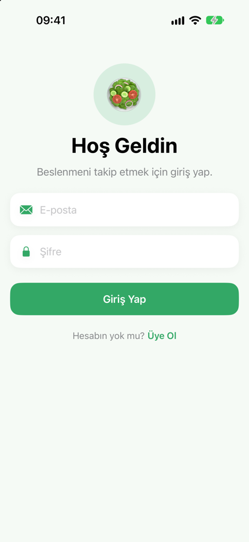
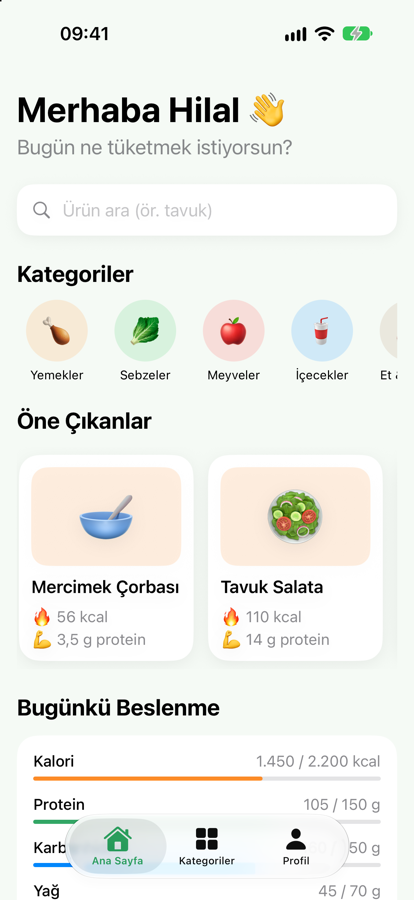
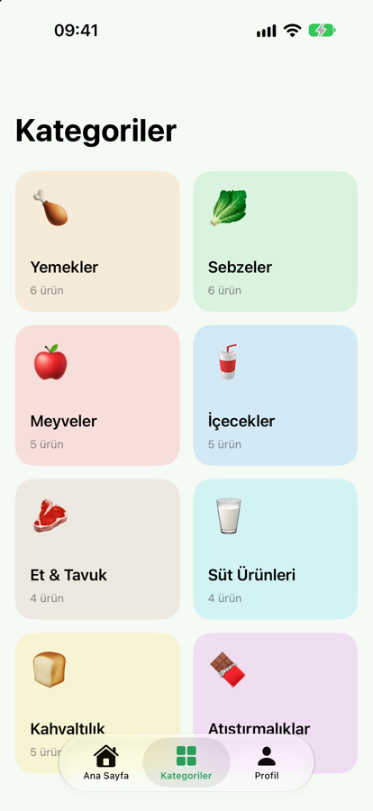
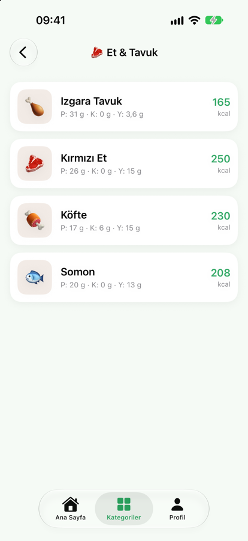
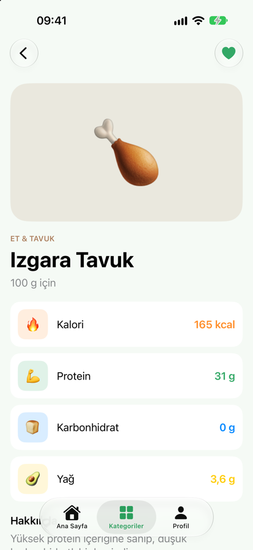
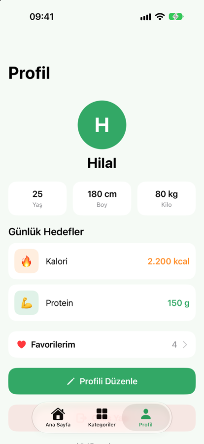

# 🥗 Diyetisyen – Beslenme Takip Uygulaması

Yiyecek ve içeceklerin **kalori, protein, karbonhidrat ve yağ** değerlerini sade ve anlaşılır biçimde gösteren bir iOS uygulaması. Kullanıcılar üye olup giriş yapabilir, ürünleri kategorilere göre inceleyebilir, arama yapabilir, favorilerini kaydedebilir ve günlük kalori/protein hedeflerini belirleyebilir.

**Swift** ve **SwiftUI** ile, **MVVM** mimarisi kullanılarak geliştirilmiştir.

<p align="center">
  
  
  
</p>
<p align="center">
  
  
  
</p>

## Özellikler

- **Üyelik ve giriş:** E-posta ve şifreyle üye olma, giriş yapma ve çıkış yapma. Oturum uygulama kapatılsa da açık kalır.
- **Ana sayfa:** Kişisel karşılama, arama, kategori kısayolları, öne çıkan ve popüler ürünler, günlük beslenme özeti.
- **Kategoriler:** 8 kategori altında 40 ürün (Yemekler, Sebzeler, Meyveler, İçecekler, Et & Tavuk, Süt Ürünleri, Kahvaltılık, Atıştırmalıklar).
- **Ürün detayı:** Porsiyon başına kalori, protein, karbonhidrat ve yağ değerleri ile kısa açıklama.
- **Arama:** Ürün ismine göre anlık arama.
- **Favoriler:** Ürünleri favorilere ekleme ve profilden listeleme.
- **Profil:** Yaş, boy, kilo ve günlük kalori/protein hedefleri; doğrulamalı profil düzenleme.
- **Lokal kayıt:** Profil ve favoriler her kullanıcı için ayrı olarak cihazda saklanır.

## Teknolojiler

| | |
|---|---|
| Dil | Swift |
| Arayüz | SwiftUI |
| Mimari | MVVM (`@Observable` view model'ler) |
| Veri saklama | UserDefaults (Codable) |
| Şifre güvenliği | CryptoKit ile tuzlanmış SHA-256 özeti |
| Minimum sürüm | iOS 17 |

## Proje Yapısı

```
NutritionApp
├── App            # Uygulama girişi, sekme yapısı, oturum yönlendirmesi
├── Models         # Food, FoodCategory, UserProfile, AppUser
├── ViewModels     # FoodViewModel, ProfileViewModel, AuthViewModel
├── Views          # Ana sayfa, kategoriler, detay, profil, giriş, üye ol
├── Components     # Ürün kartı, kategori kartı, arama çubuğu, form alanları
└── Data           # Örnek ürün verileri
```

## Çalıştırma

1. Depoyu klonlayın:
   ```bash
   git clone https://github.com/hilaltezcann/diyetisyen-app.git
   ```
2. `NutritionApp.xcodeproj` dosyasını Xcode ile açın.
3. Bir iPhone simülatörü seçip **▶︎ Run** ile çalıştırın.
4. Uygulama açılınca **Üye Ol** ekranından bir hesap oluşturun.

## Notlar

- Bu ilk sürümde sunucu (backend) yoktur; hesaplar ve veriler yalnızca cihazda saklanır.
- Besin değerleri örnek amaçlıdır; gerçek kullanım için güvenilir bir besin veri kaynağıyla doğrulanmalıdır.

## Yol Haritası

- Günlük öğün ekleme ve gerçek kalori takibi
- Su takibi ve kilo grafiği
- Haftalık beslenme raporu
- Apple Health entegrasyonu
- Backend ile gerçek kullanıcı hesapları
